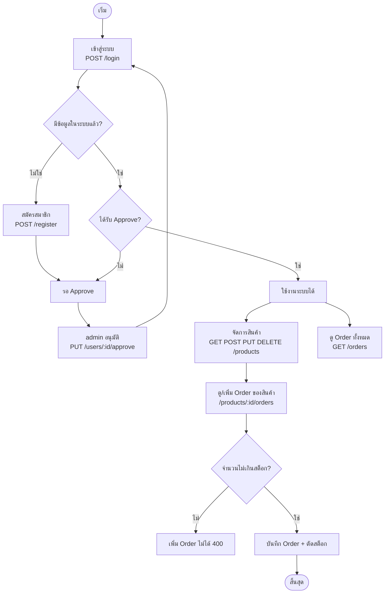

# inet-training-nodejs

ระบบ **จัดการสินค้าและใบสั่งซื้อ (Product & Order)** แบบ REST API
พัฒนาด้วย Node.js + Express + MongoDB ตามแผนภาพ `docs/training_nodejs.drawio.pdf`

> สรุปสั้นๆ: ผู้ใช้สมัครสมาชิก → **ผู้ดูแลระบบ (admin) อนุมัติ** → เข้าสู่ระบบ → จัดการสินค้า และสั่งซื้อสินค้าได้ (ห้ามสั่งเกินจำนวนในสต็อก)

---

## สารบัญ

1. [ระบบนี้ทำอะไรได้](#1-ระบบนี้ทำอะไรได้)
2. [เทคโนโลยีที่ใช้](#2-เทคโนโลยีที่ใช้)
3. [การติดตั้งและรันระบบ](#3-การติดตั้งและรันระบบ)
4. [Flow การใช้งานระบบ](#4-flow-การใช้งานระบบ)
5. [รายการ API](#5-รายการ-api)
6. [ตัวอย่างการใช้งานทีละขั้น (Postman)](#6-ตัวอย่างการใช้งานทีละขั้น-postman)
7. [รูปแบบ Response และ Status Code](#7-รูปแบบ-response-และ-status-code)
8. [โครงสร้างโปรเจกต์](#8-โครงสร้างโปรเจกต์)
9. [กฎและความปลอดภัยของระบบ](#9-กฎและความปลอดภัยของระบบ)
10. [แก้ปัญหาที่พบบ่อย](#10-แก้ปัญหาที่พบบ่อย)

---

## 1. ระบบนี้ทำอะไรได้

| ฟังก์ชัน | อธิบาย |
|---|---|
| สมัครสมาชิก | ผู้ใช้ใหม่สมัครได้เอง แต่ต้อง **รอ admin อนุมัติ** ก่อนจึงเข้าระบบได้ |
| เข้าสู่ระบบ | ได้ **token** (บัตรผ่าน) เพื่อใช้เรียก API อื่นๆ |
| อนุมัติผู้ใช้ | เฉพาะ admin เท่านั้น |
| จัดการสินค้า | ดู / เพิ่ม / แก้ไข / ลบ สินค้า |
| สั่งซื้อ (Order) | สั่งสินค้าได้ตามจำนวนที่ต้องการ **แต่ไม่เกินสต็อก** และสต็อกจะลดลงอัตโนมัติ |
| ดูประวัติ Order | ดูของสินค้าแต่ละชิ้น หรือดูทั้งระบบ |

---

## 2. เทคโนโลยีที่ใช้

| เทคโนโลยี | ใช้ทำอะไร |
|---|---|
| **Node.js** | รันโปรแกรมฝั่ง server ด้วย JavaScript |
| **Express** | เฟรมเวิร์กสร้าง API (กำหนดเส้นทาง / middleware) |
| **MongoDB** | ฐานข้อมูลเก็บข้อมูลผู้ใช้ สินค้า และ Order |
| **Mongoose** | เครื่องมือคุยกับ MongoDB และกำหนดรูปแบบข้อมูล (Schema) |
| **bcrypt** | เข้ารหัสรหัสผ่านก่อนเก็บ (ไม่เก็บรหัสผ่านจริง) |
| **jsonwebtoken (JWT)** | สร้างและตรวจ token ยืนยันตัวตน |
| **dotenv** | อ่านค่าตั้งค่า (รหัสลับ, ข้อมูลฐานข้อมูล) จากไฟล์ `.env` |
| **cors** | อนุญาตให้เว็บ frontend ต่างโดเมนเรียก API ได้ |
| **multer** | รับไฟล์รูปที่อัปโหลด (ภาพโปรไฟล์ / ภาพสินค้า) |
| **swagger-ui-express** | แสดงเอกสาร API เป็นหน้าเว็บ ลองยิง API ได้ที่ `/api-docs` |
| **nodemon** | รีสตาร์ท server อัตโนมัติเมื่อแก้โค้ด |

---

## 3. การติดตั้งและรันระบบ

### 3.1 สิ่งที่ต้องมีในเครื่อง
- [Node.js](https://nodejs.org) (ตรวจสอบ: `node -v`, `npm -v`)
- [MongoDB Community Server](https://www.mongodb.com/try/download/community) (รันที่พอร์ต `27017`)
- MongoDB Compass (ดูข้อมูลในฐานข้อมูล) และ Postman (ทดสอบ API)

### 3.2 ขั้นตอนติดตั้ง

**1) ติดตั้งแพ็กเกจทั้งหมด**
```bash
npm i
```

> ถ้าสร้างโปรเจกต์ใหม่ตั้งแต่ต้น ใช้คำสั่งติดตั้งแพ็กเกจเหล่านี้:
> ```bash
> npx express-generator --view=jade inet-training-nodejs
> npm i nodemon cors mongoose dotenv bcrypt jsonwebtoken multer swagger-ui-express
> ```

**2) สร้างไฟล์ตั้งค่า `.env`** (คัดลอกจากแม่แบบ)
```bash
cp .env.example .env
```

**3) แก้ค่าใน `.env`**

| ตัวแปร | ความหมาย | ตัวอย่าง |
|---|---|---|
| `DB_HOST` | ที่อยู่ MongoDB | `localhost` |
| `DB_PORT` | พอร์ต MongoDB | `27017` |
| `DB_NAME` | ชื่อฐานข้อมูล | `inet_training_nodejs` |
| `DB_USER` / `DB_PASSWORD` | ใส่เมื่อ MongoDB เปิดใช้รหัสผ่านเท่านั้น (ไม่ใช้ปล่อยว่าง) | |
| `JWT_SECRET` | รหัสลับสำหรับเซ็น token **(ต้องเปลี่ยนเป็นของตัวเอง)** | `my_super_secret` |
| `JWT_EXPIRES_IN` | อายุ token | `1d` (1 วัน) |
| `ADMIN_NAME` / `ADMIN_EMAIL` / `ADMIN_PASSWORD` | ข้อมูล admin คนแรก | `admin@example.com` |
| `UPLOAD_MAX_MB` | ขนาดไฟล์รูปสูงสุดที่อัปโหลดได้ (MB) | `2` |

> ระบบอ่านค่าจาก `.env` เท่านั้น ไม่ได้ฝังค่าไว้ในโค้ด และถ้าขาดค่าที่จำเป็น ระบบจะแจ้งว่าขาดตัวไหน
> **ห้าม commit ไฟล์ `.env`** (ถูกกันไว้ใน `.gitignore` แล้ว)

**4) สร้างผู้ดูแลระบบ (admin) คนแรก** — ทำครั้งเดียว
```bash
npm run seed
```
ระบบจะสร้าง admin ตามค่า `ADMIN_*` ใน `.env` (อนุมัติแล้ว พร้อมใช้งาน)

**5) รันระบบ**
```bash
npm start
```
เมื่อเห็นข้อความ `MongoDB connected: ...` แปลว่าพร้อมใช้งานที่ `http://localhost:3000/api/v1`

### 3.3 สรุปคำสั่งทั้งหมด

| คำสั่ง | ทำอะไร |
|---|---|
| `npm i` | ติดตั้งแพ็กเกจ |
| `npm run seed` | สร้าง admin คนแรก |
| `npm start` | รันระบบ (รีสตาร์ทเองเมื่อแก้โค้ด) |

---

## 4. Flow การใช้งานระบบ



**อธิบายเป็นภาษาง่ายๆ**
1. ผู้ใช้ใหม่กด **สมัครสมาชิก** → สถานะเป็น "รออนุมัติ"
2. **admin** เข้าระบบแล้วกด **อนุมัติ** ผู้ใช้คนนั้น
3. ผู้ใช้ **เข้าสู่ระบบ** → ได้ token
4. ใช้ token เรียก API สินค้าและ Order ได้
5. ตอนสั่ง Order ระบบเช็คสต็อก ถ้าพอจะบันทึกและลดสต็อก ถ้าไม่พอจะปฏิเสธ

---

## 5. รายการ API

Base URL: `http://localhost:3000/api/v1`

| Method | URL | ต้องมี token | ใครใช้ได้ | หน้าที่ |
|---|---|:---:|---|---|
| POST | `/register` | ไม่ | ทุกคน | สมัครสมาชิก (แนบภาพโปรไฟล์ `avatar` ได้) |
| POST | `/login` | ไม่ | ทุกคน | เข้าสู่ระบบ รับ token |
| PUT | `/users/me/avatar` | ใช่ | ผู้ใช้ที่อนุมัติแล้ว | เปลี่ยนภาพโปรไฟล์ของตัวเอง |
| PUT | `/users/:id/approve` | ใช่ | **admin** | อนุมัติผู้ใช้ |
| GET | `/products` | ใช่ | ผู้ใช้ที่อนุมัติแล้ว | ดูสินค้าทั้งหมด |
| POST | `/products` | ใช่ | ผู้ใช้ที่อนุมัติแล้ว | เพิ่มสินค้า (แนบภาพ `image` ได้) |
| GET | `/products/:id` | ใช่ | ผู้ใช้ที่อนุมัติแล้ว | ดูสินค้า 1 รายการ |
| PUT | `/products/:id` | ใช่ | ผู้ใช้ที่อนุมัติแล้ว | แก้ไขสินค้า (แนบ `image` ใหม่เพื่อเปลี่ยนภาพ) |
| DELETE | `/products/:id` | ใช่ | ผู้ใช้ที่อนุมัติแล้ว | ลบสินค้า |
| GET | `/products/:id/orders` | ใช่ | ผู้ใช้ที่อนุมัติแล้ว | ดู Order ทั้งหมดของสินค้า |
| POST | `/products/:id/orders` | ใช่ | ผู้ใช้ที่อนุมัติแล้ว | เพิ่ม Order (ไม่เกินสต็อก) |
| GET | `/orders` | ใช่ | ผู้ใช้ที่อนุมัติแล้ว | ดู Order ทุกรายการ |

> `:id` คือรหัส `_id` ของข้อมูลนั้นๆ (ข้อความ 24 ตัวอักษร) ที่ได้จากตอนสร้างหรือตอนดูรายการ

### การอัปโหลดรูปภาพ (multer)

| ใช้กับ | API | field ที่ส่งรูป | ผลที่ได้ |
|---|---|---|---|
| ภาพโปรไฟล์ | `POST /register`, `PUT /users/me/avatar` | `avatar` | ผู้ใช้มี `avatar` เช่น `/uploads/avatars/xxxx.png` |
| ภาพสินค้า | `POST /products`, `PUT /products/:id` | `image` | สินค้ามี `image` เช่น `/uploads/products/xxxx.png` |

**วิธีส่งใน Postman:** Body → **form-data** → ใส่ field ข้อความตามปกติ แล้วเพิ่ม key `avatar` หรือ `image` โดยเปลี่ยน type เป็น **File** แล้วเลือกรูป
(ถ้าไม่แนบรูป ส่งเป็น JSON แบบเดิมได้ รูปไม่บังคับ)

**ดูรูป:** เปิด `http://localhost:3000` ตามด้วย path ที่ได้ เช่น `http://localhost:3000/uploads/products/xxxx.png`

**กฎของระบบ**
- รับเฉพาะรูป **jpg, png, webp, gif** (ไฟล์ชนิดอื่นได้ `400`)
- ขนาดไม่เกิน `UPLOAD_MAX_MB` (ค่าเริ่มต้น 2 MB) เกินได้ `400`
- ระบบตั้งชื่อไฟล์ใหม่แบบสุ่มเอง (ไม่ใช้ชื่อไฟล์เดิม กันชื่อซ้ำและกันชื่ออันตราย)
- เปลี่ยนรูปหรือลบสินค้า → **ไฟล์รูปเดิมถูกลบออกจากเครื่องด้วย**
- ถ้าบันทึกไม่สำเร็จ (เช่น อีเมลซ้ำ ข้อมูลไม่ครบ) ไฟล์ที่เพิ่งอัปโหลดจะถูกลบ ไม่ค้างในเครื่อง
- ไฟล์เก็บที่โฟลเดอร์ `uploads/` (ไม่ถูก commit ขึ้น git)

### เอกสาร API แบบโต้ตอบ (Swagger UI)

เมื่อรันระบบแล้ว เปิด **http://localhost:3000/api-docs** จะเห็นรายการ API ทั้งหมดพร้อมตัวอย่าง Body/Response และกดทดลองยิงได้เลย

วิธีใช้กับ API ที่ต้องมี token:
1. ยิง `POST /login` แล้วคัดลอก `data.token`
2. กดปุ่ม **Authorize** ด้านบนขวา → วาง token (ไม่ต้องพิมพ์ `Bearer`) → **Authorize**
3. กด **Try it out → Execute** ที่ API ใดก็ได้

ไฟล์เอกสารอยู่ที่ `swagger.js` (มาตรฐาน OpenAPI 3.0) ถ้าเพิ่ม/แก้ API ให้แก้ไฟล์นี้ตามด้วย

---

## 6. ตัวอย่างการใช้งานทีละขั้น (Postman)

> ส่งข้อมูลทาง **Body → raw → JSON** (ไม่ใช่ Params)
> API ที่ต้องมี token: แท็บ **Authorization → Bearer Token** แล้ววาง token

### ขั้นที่ 1: สมัครสมาชิก (ผู้ใช้ใหม่)
`POST /api/v1/register`
```json
{ "name": "Somchai", "email": "somchai@example.com", "password": "1234" }
```
ผลลัพธ์ `201` — `"registered, waiting for approval"` (ยังเข้าระบบไม่ได้)

### ขั้นที่ 2: admin เข้าสู่ระบบ
`POST /api/v1/login`
```json
{ "email": "admin@example.com", "password": "ค่า ADMIN_PASSWORD ใน .env" }
```
คัดลอก `data.token` ของ admin เก็บไว้

### ขั้นที่ 3: admin อนุมัติผู้ใช้
`PUT /api/v1/users/<id ของ Somchai>/approve` (ใส่ token ของ admin)
ผลลัพธ์ `200` — `"approved"`

### ขั้นที่ 4: ผู้ใช้เข้าสู่ระบบ
`POST /api/v1/login`
```json
{ "email": "somchai@example.com", "password": "1234" }
```
คัดลอก `data.token` ของผู้ใช้ไว้ใช้ต่อ

### ขั้นที่ 5: เพิ่มสินค้า
`POST /api/v1/products`
```json
{ "name": "Pen", "description": "Blue pen", "price": 10, "stock": 100 }
```
คัดลอก `data._id` ของสินค้า

> **แนบภาพสินค้า:** ใช้ Body → form-data ใส่ `name`, `price`, `stock` เป็น Text และ `image` เป็น File

### ขั้นที่ 6: สั่งซื้อ (Order)
`POST /api/v1/products/<id สินค้า>/orders`
```json
{ "quantity": 3 }
```
- สำเร็จ `201` และสต็อกลดจาก 100 เหลือ 97
- ถ้าสั่งเกินสต็อก ได้ `400` — `"cannot add order: quantity exceeds stock"`

### ขั้นที่ 7: ดูข้อมูล
- `GET /api/v1/products/<id>` — ตรวจสต็อกที่เหลือ
- `GET /api/v1/products/<id>/orders` — Order ของสินค้านี้
- `GET /api/v1/orders` — Order ทั้งระบบ

**เคล็ดลับ:** เก็บ token อัตโนมัติ ที่ request login แท็บ **Scripts → Post-response** ใส่
```js
pm.environment.set("token", pm.response.json().data.token);
```
แล้วที่ Authorization ใส่ `{{token}}` (ต้องเลือก Environment ก่อน)

---

## 7. รูปแบบ Response และ Status Code

ทุก API ตอบกลับรูปแบบเดียวกัน
```json
{
  "status": 200,
  "message": "success",
  "data": []
}
```

| status | ความหมาย | ตัวอย่างเหตุการณ์ |
|:---:|---|---|
| **200** | สำเร็จ | ดู/แก้ไข/ลบ สำเร็จ |
| **201** | สร้างสำเร็จ | สมัครสมาชิก, เพิ่มสินค้า, เพิ่ม Order |
| **400** | ไม่สำเร็จ | ข้อมูลไม่ครบ, ไม่พบรายการ, อีเมลซ้ำ, สั่งเกินสต็อก |
| **401** | ไม่มีสิทธิ์ | ไม่มี/หมดอายุ token, รหัสผิด, ยังไม่ได้รับ Approve |
| **500** | ไม่ทราบสาเหตุ | ข้อผิดพลาดภายในระบบ |

**ค่าใน `data`**

| กรณี | ค่า | status |
|---|---|:---:|
| ดูหลายรายการ ไม่มีข้อมูล | `[]` | 200 |
| ดูหลายรายการ มีข้อมูล | `[{...}, {...}]` | 200 |
| ดูรายการเดียว ไม่พบ | `null` | 400 |
| ดูรายการเดียว พบ | `{...}` | 200 |
| บันทึกสำเร็จ | `{...}` | 201 |

---

## 8. โครงสร้างโปรเจกต์

```
inet-training-nodejs/
├── app.js                  จุดเริ่มต้น: ตั้งค่า middleware, ผูก routes, จัดการ error
├── config.js               อ่านและตรวจค่าจาก .env
├── db.js                   เชื่อมต่อ MongoDB
├── swagger.js              เอกสาร API (OpenAPI) สำหรับ Swagger UI ที่ /api-docs
├── .env / .env.example     ค่าตั้งค่า (.env ไม่ถูก commit)
│
├── models/                 รูปแบบข้อมูลในฐานข้อมูล (Schema)
│   ├── user.model.js         ผู้ใช้ (role, approved)
│   ├── product.model.js      สินค้า (price, stock)
│   └── order.model.js        Order (product, user, quantity, totalPrice)
│
├── routes/                 เส้นทาง API
│   ├── auth.js               register, login
│   ├── users.js              approve
│   ├── products.js           สินค้า + Order ของสินค้า
│   └── orders.js             Order ทั้งหมด
│
├── middleware/auth.js      ตรวจ token และสิทธิ์ (auth, adminOnly)
├── utils/                  ตัวช่วย: รูปแบบ response, จัดการ error แบบ async, อัปโหลดรูป (upload.js)
├── scripts/seed.js         สร้าง admin คนแรก
├── uploads/                รูปที่ผู้ใช้อัปโหลด (avatars/, products/) — ไม่ถูก commit
└── docs/                   เอกสาร diagram
```

---

## 9. กฎและความปลอดภัยของระบบ

- **รหัสผ่านไม่ถูกเก็บจริง** — เก็บเป็นค่า hash (bcrypt) และไม่ส่งกลับใน response
- **token (JWT)** — หมดอายุตาม `JWT_EXPIRES_IN` และระบบตรวจซ้ำทุกครั้งว่าผู้ใช้ยังอยู่และยังได้รับอนุมัติ
- **เฉพาะ admin** ที่อนุมัติผู้ใช้ได้ (ผู้ใช้ทั่วไปได้ `401 admin only`)
- **สต็อกปลอดภัย** — ตัดสต็อกแบบ atomic ต่อให้มีคนสั่งพร้อมกัน สต็อกก็ไม่ติดลบ
- **ค่าลับอยู่ใน `.env`** — ไม่ฝังในโค้ดและไม่ถูกอัปขึ้น git
- **รับเฉพาะ field ที่อนุญาต** — กัน field แปลกปลอมที่ส่งเข้ามา
- **อัปโหลดปลอดภัย** — จำกัดชนิดและขนาดรูป ตั้งชื่อไฟล์สุ่มเอง และลบไฟล์ที่ไม่ใช้แล้ว

---

## 10. แก้ปัญหาที่พบบ่อย

| อาการ | สาเหตุ / วิธีแก้ |
|---|---|
| `Missing required env: ...` | ไฟล์ `.env` ขาดค่านั้น ให้เติมตาม `.env.example` |
| `MongoDB connection error` | MongoDB ยังไม่ได้รัน หรือ `DB_HOST`/`DB_PORT` ไม่ตรง |
| login ได้ `401 waiting for approval` | ยังไม่ได้รับ Approve ให้ admin อนุมัติก่อน |
| `401 token required` | ลืมใส่ token ที่ Authorization → Bearer Token |
| `401 invalid or expired token` | token ผิดหรือหมดอายุ ให้ login ใหม่ |
| `400 invalid id` | ใส่ `:id` ผิดรูปแบบ (เช่น พิมพ์ `<id>` ตรงๆ) ให้ใช้ `_id` จริง |
| `400 email already exists` | อีเมลนี้สมัครไปแล้ว ใช้อีเมลอื่น |
| `400 cannot add order: quantity exceeds stock` | สั่งเกินสต็อก ลดจำนวนหรือเพิ่มสต็อกสินค้า |
